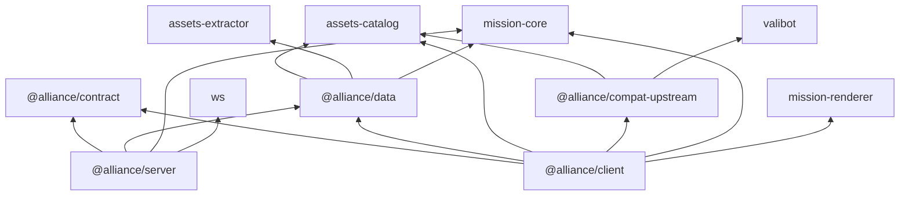
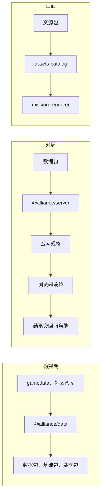

# 架构

## 包

| 目录 | 包 | 职责 |
| --- | --- | --- |
| `alliance/contract` | `@alliance/contract` | 客户端与服务端共用的消息与版本 |
| `alliance/data` | `@alliance/data` | 赛季数据包与资源包的构建器，以及读取 |
| `alliance/server` | `@alliance/server` | 对局进程：HTTP、WebSocket、房间与对局 |
| `alliance/client` | `@alliance/client` | 浏览器客户端与开发服务器 |
| `alliance/compat/upstream` | `@alliance/compat-upstream` | 连接 master 后端的兼容层 |

## 依赖

箭头表示「依赖」方向。库名省略前缀 `arknights-`。

- 库不依赖应用。`assets-extractor` 只被 `@alliance/data` 的构建脚本使用，不进入客户端与服务端的产物
- 服务端只读赛季数据包，不读资源清单与媒体文件
- 明日方舟的语义（干员、敌人、语音槽位、赛季）只在 `@alliance/data`，两个资源库只认识键

## 数据流

- 数据与资源的流水线见 [资源从哪里来](./data/03-resource.md)
- 战斗默认在浏览器里按服务端发来的规格演算，服务端验收结果，见 [作战](./protocol/05-combat.md)
- 连接 master 后端时，资源改由 `@alliance/compat-upstream` 从后端的资源表生成，见 [连接 master 后端](./compat/index.md)
