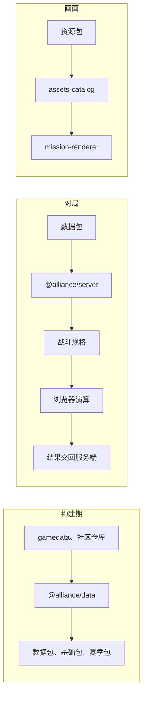

# 架构

## 包

| 目录 | 包 | 职责 |
| --- | --- | --- |
| `alliance/contract` | `@alliance/contract` | 客户端与服务端共用的消息与版本 |
| `alliance/data` | `@alliance/data` | 赛季数据包与资源包的构建器，以及读取 |
| `alliance/server` | `@alliance/server` | 对局进程的连接层：HTTP 与 WebSocket |
| `alliance/client` | `@alliance/client` | 浏览器客户端与开发服务器 |
| `alliance/ui` | `@alliance/ui` | 设计令牌、基础样式与基础组件（React Aria），模组可用的界面 API；组件文档与组件同目录 |
| `alliance/compat/upstream` | `@alliance/compat-upstream` | 连接 master 后端的兼容层 |

- 库不依赖应用。`assets-extractor` 只被 `@alliance/data` 的构建脚本使用，不进入客户端与服务端的产物
- 服务端只读赛季数据包，不读资源清单与媒体文件
- 明日方舟的语义（干员、敌人、语音槽位、赛季）只在 `@alliance/data`，两个资源库只认识键

完整依赖图（含四个库与第三方库）见 [包依赖](./03-deps.md)。

## 目录

`alliance/contract` 的源码是四个文件：

```text
alliance/contract/src/
  catalog.ts
  match.ts
  message.ts
  server-message.ts
```

`alliance/server`：

```text
alliance/server/
  connection/     HTTP、地址、会话与 WebSocket
  entry/main.ts   Vite 构建的 ssr 入口
```

`alliance/compat/upstream` 里，客户端调用 `data/` 与 `battle/`：

```text
data/
  asset/        master 地址到资源键，并生成 upstream 清单
  catalog/      master 的表收成目录
  view/         战斗属性、关卡地图、结算与推流
battle/
  spec.ts       b.start 收成 BattleSpec
  progress.ts   账本收成 b.progress
  skill.ts      技能记录收成 SkillSpec
  result.ts     账本与胜负收成 b.result
case-map/       master 用例在 next 的去向
trace/          引擎规则的出处
```

## 数据流



- 数据与资源的流水线见 [资源从哪里来](./data/03-resource.md)
- 战斗默认在浏览器里按服务端发来的规格演算，服务端验收结果，见 [作战](./protocol/05-combat.md)
- 连接 master 后端时，资源改由 `@alliance/compat-upstream` 从后端的资源表生成，见 [连接 master 后端](./compat/index.md)
