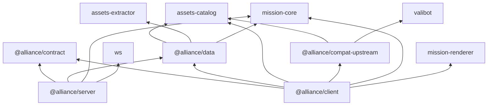

# 包依赖

包职责与对局数据流见 [架构](./02-architecture.md)。这里展开依赖图，供改包边界或排查「谁能引用谁」时用。

箭头表示「依赖」方向。库名省略前缀 `arknights-`。

- 库不依赖应用。`assets-extractor` 只被 `@alliance/data` 的构建脚本使用，不进入客户端与服务端的产物
- 服务端只读赛季数据包，不读资源清单与媒体文件
- 明日方舟的语义（干员、敌人、语音槽位、赛季）只在 `@alliance/data`，两个资源库只认识键

资源流水线里各包的分工见 [资源从哪里来](./data/03-resource.md#包之间的关系)。连接 master 后端时的图层与映射见 [连接 master 后端](./compat/index.md)。编译器目录见 [数据编译器与目录](./data/04-directory.md)；客户端分层见 [客户端目录与分层](./client/17-directory.md)。
