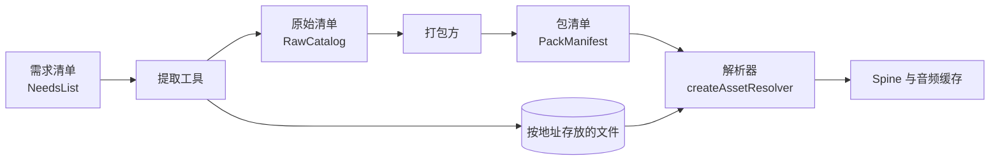
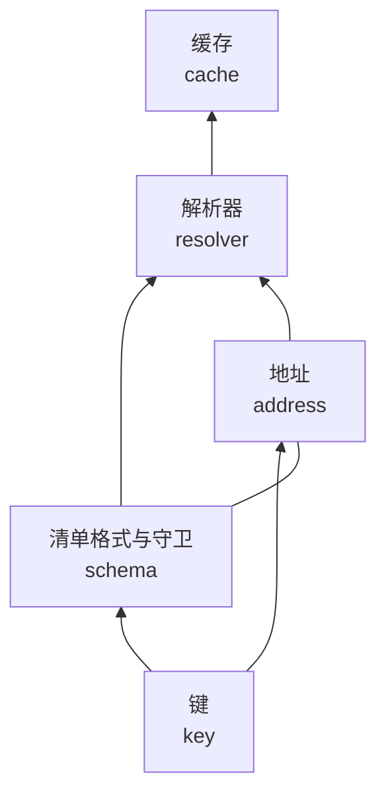

# 架构设计

`arknights-assets-catalog` 只处理「键」与「清单」：构建期的工具写清单，运行时的代码读清单，双方通过键交接，不共享别的状态。

## 在资源流水线中的位置

- **提取**：读需求清单，写文件、原始清单与 Spine 元数据。用到本包的键、守卫与 `fileAddress`
- **打包**：读原始清单，写包清单。用到本包的键与守卫
- **运行时**：读包清单。用到解析器、地址与缓存

提取工具与打包方都在本包之外；[arknights-assets-extractor](../assets-extractor/index.md) 是其中一种提取工具。

## 包内分层

- 键在最底层，只依赖自身
- 清单格式与地址互相引用：文件规则要知道哪些种类是多文件，地址要知道文件条目的形状
- 解析器组合清单与地址，把条目变成带绝对地址的结果
- 缓存只依赖解析结果的形状，不依赖解析器本身；调用方也可以自己构造 `SpineSource`、`AudioSource`
- 整个包只有一个入口，入口只导出公开接口

## 键是身份

资源的身份是键，不是内容哈希。

- 同一份字节出现在两个键下，就是两个资源：各有条目、各有地址、各占一条缓存
- 内容哈希只用于下载校验、清单的 `contentHash`、地址的版本参数与增量发布
- 跨包只传键：种类从键推出，地址由地址模块算出，回退目标写在清单条目上

这样，资源换了内容不改身份，两个资源恰好相同也不会互相牵连。

## 清单只放引用

包清单不写来源地址、不写 Spine 动画信息、不写业务字段。

- 领域 id 到键的映射写在 `refs`，形状由打包方定义，本包只要求叶子是合法键
- 包的类型由打包方命名，本包不限定取值
- 同一个解析器因此可以服务任何使用这套格式的项目

## 覆盖层整条替换

解析器把清单从低到高叠起来：

- 同一个键，高层整条替换低层。部分字段合并会让一个条目的文件来自两个包，校验与回退都不再可靠
- `refs` 按 JSON 路径合并，高层可以只改一个 id 的一个槽位
- 回退沿 `fallbackId` 进行，每一环都取最高层的条目，所以高层既能替换资源本身，也能替换它的回退目标

回退分两种：

- **物理回退**：条目的 `fallbackId`。解析器只执行这条链
- **领域回退**：例如「高阶头像缺失时用基础头像」。由打包方把两个键都写进清单并设置 `fallbackId`，解析器不推断领域规则

## 一套地址

提取缓存、开发服务与线上部署使用同一套相对地址。

- 所有种类同一种格式，没有按种类的特殊路由
- 文件用可读的路径加 `?v=<hash>`，开发时容易排查，线上可以长期缓存
- 几份清单的 `fileRoot` 指向同一个文件目录时，相同地址的文件只存一份
