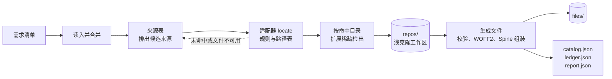

# 架构设计

## 数据流



候选来源依次尝试；全部失败的键写进 `missing`。步骤见 [提取与输出](./04-output.md#步骤)。

## 依赖边界

- 依赖 `arknights-assets-catalog`：键、需求清单与原始清单的类型和守卫、文件地址
- `arknights-assets-catalog` 不依赖本包
- 运行时代码不引用本包，浏览器与服务端的构建产物里不会出现它的依赖
- 文件系统与 git 都通过端口（`BuildFiles`、`GitProcess`）访问，测试可以替换

## 设计取舍

- **适配器只做映射**：克隆、检出、校验、转换与写文件是共用代码，新增来源只写「键 → 上游文件」
- **同名多候选算未命中**：全部候选写进报告的 `ambiguous`，不从中挑选一个
- **只检出命中的目录**：浅克隆不下载文件内容，稀疏检出只取命中文件所在的目录
- **输出可复现**：原始清单按键排序，同一输入两次运行字节一致；账本按输入哈希复用

## 源码结构

```text
assets-extractor/
  source/                 来源适配器
    asset-source.ts       AssetSource、SourceHit、SourceContext
    table.ts              来源表与 createSources
    path-table.ts         路径表（paths.json）的读取与校验
    repository.ts         git 来源共用的工作区与命中构造
    name.ts               safeName 与文件名工具
    yuanyan/ fexli/ ark-models/ fonts/ gamedata/   各来源的 adapter.ts
    arknights-assets/     adapter.ts 与界面图路径表
    voice/                adapter.ts 与 BGM、音效路径表
    local-client/python/  本机客户端提取脚本
  download/
    repo-cache.ts         浅克隆、稀疏检出、版本检查、重试与代理
    repo-index.ts         从树对象读出的文件列表与按名查找
    sparse.ts             由命中文件算出 cone 目录集合
    format.ts             文件格式校验
    ledger.ts             文件账本
  spine/                  图集规范化、骨架解析、Spine 组装与元数据
  font/                   WOFF2 编码
  catalog/
    extract.ts            一次提取：查找、检出、生成文件、写清单与报告
    needs.ts              读取并合并需求清单
    raw-catalog.ts        原始清单的规范化与序列化
    report.ts             报告类型
    cache-layout.ts       缓存目录布局
  port/                   文件与 git 进程端口
  script/extract.ts       pnpm extract 命令
  test/                   跨多个源文件的用例（.spec.ts）与小样本夹具
  index.ts                包的导出入口
```

- 只测一个源文件的用例与源码放在一起，文件名用 `.test.ts`
- 包内引用用 `package.json` 的 `imports` 别名（`#source/*`、`#download/*` 等）
