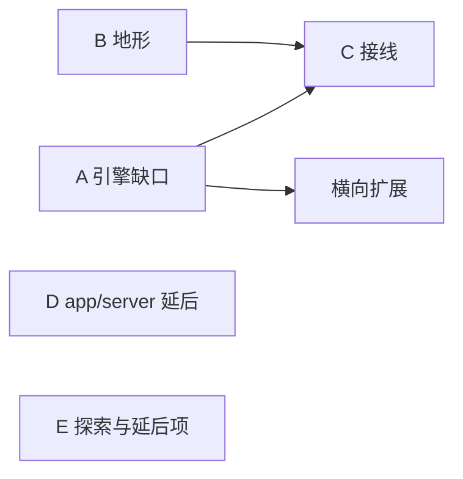

- [目标与前提](#目标与前提)
- [当前状态速览](#当前状态速览)
  - [mission-core](#mission-core)
  - [mission-renderer](#mission-renderer)
  - [两包共同](#两包共同)
  - [用例对照表](#用例对照表)
- [剩余工作](#剩余工作)
  - [阶段 A：引擎缺口](#阶段-a引擎缺口)
  - [阶段 B：地形](#阶段-b地形)
  - [阶段 C：接线](#阶段-c接线)
  - [阶段 D：app/server（延后）](#阶段-dappserver延后)
  - [阶段 E：探索与延后项](#阶段-e探索与延后项)
- [横向扩展](#横向扩展)
  - [上游画面行为](#上游画面行为)
  - [特效种类](#特效种类)
  - [动画与头顶条](#动画与头顶条)
  - [官方地形（第一批之后）](#官方地形第一批之后)
  - [三维地面](#三维地面)
  - [master 画面用例逐条核对](#master-画面用例逐条核对)
- [共同约定](#共同约定)
- [待决事项](#待决事项)

本文是 `mission-core` 与 `mission-renderer` 借鉴 ECS 重构之后的全部剩余工作，交给接手后续工作的实施者，在新分支上进行。本文自成一体：已实现的设计以对应模块文档为准，这里只写必须守住的约束、剩余工作与验收。架构方向以 ARCH.md 与 FEATURE.md 为准。

## 目标与前提

已实现的设计见：

- 内核（World、组件、资源、标签、注册表、阶段排序）：「mission-core 文档中的世界、组件、资源与标签」、「mission-core 文档中的模块」、「mission-core 文档中的确定性数学与整帧对齐」
- 类型化事件、系统顺序、账本、导出与导入：「mission-core 文档中的战斗」
- 类 GAS 的效果与属性、纯数据规格：「mission-core 文档中的效果与属性」、「mission-core 文档中的规格」、「mission-core 文档中的技能」
- 上游通用机制：「mission-core 文档中的攻击」、「mission-core 文档中的伤害」、「mission-core 文档中的选择器」、「mission-core 文档中的计时」、「mission-core 文档中的费用、阻挡与投射物」
- 黄金回放、源码扫描与追溯标记：「mission-core 文档中的黄金回放与源码扫描」、「mission-core 文档中的追溯标记」
- renderer 契约、舞台与喂数：「mission-renderer 文档中的契约」、「mission-renderer 文档中的舞台」、「mission-renderer 文档中的本地喂数」、「mission-renderer 文档中的地面」
- 资源端口、演员（骨骼、头顶条、替身）：「mission-renderer 文档中的资源端口」、「mission-renderer 文档中的演员」
- 特效表、线索绑定与封存、音效线索：「mission-renderer 文档中的特效与线索绑定」、「mission-renderer 文档中的音效线索」

剩余目标：

- 补齐引擎缺口（玩家输入、替身、头顶条、技能音库），核对几项记为完成但代码里找不到的机制。
- 地形：核心提供通用的地块地形机制，内容注册官方地形。
- 把引擎接到 `app/client` 与 `app/data`。
- 按已定的接口横向扩展上游画面行为与特效种类，逐条核对 master 的 `test/render/`。
- 整理探索项与延后项。

前提：

- 重写而非移植：master 参考副本（本地检出，运行 case-map 时用 --repo 指定路径）只用来找正确行为，不照搬结构。
- 引擎机制高扩展：新机制通过注册接入，不改核心类型和分支；引擎里不出现干员名、敌人名或卫戍协议专有概念，个别机制写在内容模块。
- 单场只有几十个单位，性能不是瓶颈；扩展压力来自个别机制与大量特效种类。

## 当前状态速览

以下是实施中必须守住的架构事实。改动其中任何一条，先提出并经确认。

### mission-core

- 确定性：时间只来自拍数，随机只来自种子流；近似 `Math.*`、时钟与系统熵由确定性扫描禁止，改用 `kernel/math/` 与 `kernel/tick/` 的 `countdown`、`reached`；比较容差用 `kernel/math/epsilon.ts` 与 `kernel/tick/` 的命名常量，不写字面量 `1e-9`。迭代顺序稳定（插入序，同序按 `spawnSeq`），模块按规格与依赖固定顺序安装。
- 黄金回放（`test/golden/`，基线 `baseline.json`）是 next 自身的基线：重构前后逐字节一致；行为有意变化时单独提交，在提交说明里写清变动的场景与原因，再 `pnpm vitest run test/golden -u`。与 master 对拍只作一致性指标，不作验收。
- `World` 内部可变，只经 `Battle.step(inputs)` 修改；`export()`/`import()` 产出与恢复纯数据（单位记录、组件表、资源，非纯数据经 `codec`），不含快照的 `components` 视图。输入日志由调用方保存，`export()` 不含输入历史。
- 账本只按 `UnitSpec.owner`（不透明字符串）记录；核心没有玩家与房间的概念，边界扫描锁定。按玩家汇总在 app/server。
- 标签：`defineTag` 返回带类型的键，按来源 `grant`/`revoke`，唯一的查询是 `hasTag`（含蕴含）。id 全部 kebab-case；核心语义集合封闭（见 「mission-core 文档中的核心标签」），官方内容模块可注册自己的标签；规格里未注册的标签在建战斗时报错；模组暂不能新增标签。
- 事件：`BattleEventMap`、`CueMap` 经声明合并扩展，事件名 kebab-case；master 线路上的 `EV` 名对照只在兼容层。
  - `intercept` 只用于 `Intercept<>` 标记的事件：`attack`（取消普攻）、`fatal`（保留 1 点生命）、`palsy-interrupt`（是否保留麻痹）。
  - 其余经 `emit` 进本拍 FIFO 队列，载荷只读；订阅者里再发的事件排到队尾，不递归。钩子里重入 `step` 抛错；核心不丢事件、不吞异常。
- 数值修改不走拦截：伤害经修饰管线的 `hit`、`element-hit`、`hp` 阶段（`hp` 在护盾之后，只能降低）；效果施加经同一管线的 `effect` 阶段，在免疫之后、叠加之前（内置 `effect-resist`、`effect-heavy`）。见 「mission-core 文档中的伤害修饰」。
- 快照：玩法状态（阻挡、元素、技能的 sp 与弹药、护盾、重部署、倒下、朝向、高度、失衡、有效 `maxHp`）是顶层字段，计入状态哈希与黄金摘要；`components` 视图只放可由状态推导的表现数据，不计入哈希与导出。
- 扩展：可扩展 id 用 `defineExtensible` 标记、逐步开放（技能触发、技能体、选择器、伤害步骤、叠加策略、条件、部署策略、`element`）；系统与组件不开放替换；其余同 id 再注册报 `RegistrationConflictError`；模组暂不能新增阶段槽。规格是纯数据，钩子写成注册 id。
- 玩家输入：`BattleInput` 目前只有 `retreat`、`redeploy`、`cast`（「mission-core 文档中的玩家输入」）；部署仍由规格与部署模块驱动。
- 地块：`TileSpec` 只有几何与通行（`height`、`deployable`、`walkableBy`、`objective`），没有地形语义；寻路的同分规则少踩「不可阻挡格」（见 「mission-core 文档中的寻路」）。

### mission-renderer

- renderer 只读快照、事件、cue 与资源句柄：资源按调用方给的 `AssetKey` 经资源端口申请，表现数据由 app 经 `set-appearances` 传入，renderer 不读 `chess.json`、`enemies.json`。
- `@pixi/*`、`@pixi-spine/*` 只能被 `actor/skeleton/` 引用，只做骨骼与动画计算，不创建 Pixi 渲染器、显示对象与纹理（`test/dependency.spec.ts`）。骨骼经 `port/skeleton.ts` 端口使用，换运行时只换 `actor/skeleton/`。
- 视图系统按 `MISSION_VIEW_SYSTEM_ORDER` 固定顺序逐帧运行，顺序表导出并测试；`cull` 按地面相机视锥剔除演员与特效对象，没有 LOD。
- 资源端口按种类设置颜色空间、mipmap 与各向异性（`MISSION_TEXTURE_POLICY`）；地面尺寸常量 `TILE_SIZE`、`TILE_HEIGHT` 都在 `ground/tile.ts`。
- 特效表、线索绑定、头顶条读数表在 `createMissionStage` 时封存，之后 `register`、`replace`、`bind` 抛错，不支持热重载；封存校验一次列出全部问题（`RangeError`），包括内容 `declare` 过的 cue 种类必须有绑定。
- 键的写法：
  - 特效 id 与读数 id：`<namespace>:<name>`，kebab-case，名字可用 `/` 分段；引擎自带的用 `mission:`。
  - 线索键：核心事件用事件名本身（不带冒号）；内容的线索种类用 `cue:<kind>`（裸 `cue` 不能绑定）；模组事件用 `<namespace>:<name>`。
  - 绑定 `{ effect, sound }` 中的 `null` 表示明确不画或不发声；没有绑定的键不画不响，只调用一次 `onUnboundCue`。`MISSION_EVENT_BINDINGS` 的类型要求每个核心事件都有绑定。
- 效果等待链接续时画面不补闪烁，不补发事件，不发状态音效。

### 两包共同

- 公开模块（`mission-core`、`mission-renderer`、`assets-catalog`、`assets-extractor`）导出时不改名：不写 `export { X as Y }`、`export * as`，内部直接用公开名。
- 追溯标记：需要指向依据时写 `// TRACE: <种类>/<名字>`，说明集中在 mission-core 文档中的追溯标记；master 标为 [ASSUMED] 的规则照搬并加 `assumed/*`。两包都有追溯扫描。
- 引擎不引用 `app/compat`、`app/client`、`app/server`。
- app/server 迁移未完成、落地延后：它的全量测试、lint 与排练机器人耗时都不是验收。核心契约变动时，适配文件（如 `app/server/content/support/battle-facade.ts`）须在 `app/server` 内 `tsc --noEmit` 通过，只做最小修复。

### 用例对照表

对照记在 `app/compat/upstream/case-map/mapping.json`，用法见 「alliance/compat 文档中的用例对照表」。在 `app/compat/upstream` 内运行 `pnpm build && pnpm case-map --repo <master 参考副本路径>`（该目录须已 `npm ci`）。不改 master 的测试，不在 next 的测试名或注释里写 master 引用。

现状（master `1db8e510`，2026-10-11 核对）：

- `sim/**` 逐条 844 条：`rewritten` 215、`covered` 30、`moved` 586、`not-migrated` 12、`pending` 1。唯一的 `pending` 是 `playtest5-targeting.test.js` #1（近地悬浮敌人无视深水），`step` 写的 `ECS 6`，由阶段 B 处理；它的 `reason` 写成了「选择器排序与对空限制」，处理时一并改正。
- `render/**` 仍是一条 `pending` 规则（`step` 写的 `ECS 8`），覆盖 72 个文件、662 条用例，在横向扩展中逐条处理。
- 处理这两项时，把 `step` 改成本文的阶段名（如 `REMAIN-ECS B`）。

## 剩余工作

顺序：A 与 B 可以并行；C 在 A 的接口与 B 的地块规格确定后，随 `app/client` 落地推进；横向扩展在 A 之后，可与 C 并行；D 随 app/server 落地；E 随时可做。

### 阶段 A：引擎缺口

- 目标：补齐 `app/client` 接入前引擎侧还缺的接口与画面。
- 范围：`mission-core/contract/input.ts`、`battle/`、`unit/deploy/`、`ability/skill/`、`combat/`、`test/golden/`；`mission-renderer/actor/`（`impostor/`、`hud/`、`entity/`）、`audio/`、`contract/`；对应模块文档。
- 交付：
  - 局中玩家操作改为 `BattleInput`：开局放置的初始单位属于 `BattleSpec`，不是输入；局中所有玩家操作（部署、撤退、重部署、施放等）均为 `BattleInput`。接受时发 `input`，拒绝时发 `input-refused`，与现有三种输入一致。黄金场景改为由输入驱动的部分作为有意变更单独提交，记录变动的场景。
  - 替身接到演员：演员按 `impostorDue` 的本帧更新序刷新替身；图集从等大格子改为货架分配与分页（含 clip 页），参照 master `render/impostor.js` 的行为。
  - 技能期间的攻击、命中音按技能槽选择音库（master 0.2.3 §28.17）：技能槽作为核心技能相关事件（如 `attack`、`hit`）的字段携带，快照只保留连续状态；音效线索带上技能槽，选择规则在 `app/client/audio`。先到的技能音（§27.44）一并处理。
  - 头顶条：状态图标（冻结、眩晕、沉睡、无敌、隐身等，读标签）、重部署圈（快照的重部署计时，数字纹理共享，§28.8）、残影血条、首领与精英框（读快照上已注册的标签，如 `boss`/`elite`；`components` 视图只是表现推导数据，不读它；若尚无此类标签，由内容注册）。
  - 核对四项机制。原计划把它们记为已完成，但 `mission-core` 里没有找到对应实现，模块文档也没有写。逐项确认是已用别的机制覆盖（补文档、补用例），还是确实缺失（补实现）：
    - 立即生效、本身不是攻击的技能，两次释放至少隔一个攻击间隔（master 0.2.2 §27.18，`sim/skills.js nextCastAt`）。现有代码只有 `MANUAL` 的 3 秒自动释放冷却。
    - 触发源的 `cadence: "attack"`（§28.4、§28.13，master `addTriggerRange(fn, { attackOnly })`）：现有的 `setTriggerArea`（「mission-core 文档中的技能」）只有每拍问，没有等到下一次普攻时点的选项。
    - 没有敌人时的替代目标（如治疗半血友方）与治疗、攻击混合触发（§28.10）：攻击系统里没有替代目标的扩展点。
    - 友方装置在敌方条件里算作敌人（§27.6）：原计划写的标签是 `hostile-target`，代码里只有 `ally-target`（同阵营的普攻也选它）。确认 `ally-target` 是否覆盖 §27.6 的技能条件（`sim/skills.js _allyTargetIn`）。
- 验收：两包内 `pnpm test`、`pnpm lint` 通过，追溯与确定性扫描通过；输入的接受与拒绝、导出导入后继续推进的用例；四项核对各有结论与用例；替身分页与刷新顺序、头顶条各项用演员的录制快照加假时钟测试；黄金摘要只有记录在案的有意变动；`pnpm perf` 结果与上一阶段比较。

### 阶段 B：地形

- 目标：核心提供通用的地块地形机制（站在地块上得到效果、离开时撤下或延续、影响寻路与部署），官方地形由内容注册。核心不认识沼泽、深水这些具体地形。
- 范围：`mission-core/contract/spec.ts`（`TileSpec`）、`port/`（地形定义与注册）、`field/grid/`（地形查询、寻路代价、网格版本）、新的 `field/terrain/`、`combat/damage/`（伤害标签）、`battle/`（系统顺序）、`test/`；`app/data`、`app/server/match/fight/field/`、`app/server/content/device/`；mission-core 文档。
- 交付：
  - 核心机制：
    - 地块规格：`TileSpec` 加可选的 `terrain?: string`，值是已注册的地形 id；未注册的 id 在建战斗时报 `UnknownRegistrationError`。这是通用语义，不是模式专用字段；高台、近战位、远程位仍由 app 解释。是否这样做先经确认（待决事项）。
    - 地形定义：`defineTerrain(id, { effect?, linger?, period?, onEnter?, onStay?, onLeave?, affects?, pathCost?, deployable? })`，内容用 `registerTerrain` 注册，可用 `defineExtensible` 标记以便模组替换。`effect` 是站上去时施加的效果 id（来源记为 `terrain:<id>`），离开时撤下；`linger` 是离开后仍保留的秒数，站在上面时每拍刷新回满（活性源石）；`period` 与 `onStay` 给按秒触发的规则（沼泽每秒加层）；`affects` 选择受影响的阵营与移动方式，缺省只影响地面单位。
    - 站位：每拍在一个固定的系统里，按单位当前所站的地块算出地形：友方按部署格，敌人按取整后的坐标；飞行、带 `airborne` 标签（浮空、近地悬浮）与路线隐藏的单位不受地面地形影响，除非定义的 `affects` 写了。站位记在组件 `terrain:standing`（地形 id、进入的拍、触发次数），地形变了时依次调用旧地形的离开与新地形的进入，送出 `terrain-enter`、`terrain-leave` 事件。系统放在哪个槽、与效果计时器的先后，写进系统顺序表。
    - 寻路：`pathCost` 给地面流场的格子代价（缺省 1）。现有「同分少踩不可阻挡格」的规则保留：深水是地面可走但不可部署的格，已经算在不可阻挡格里，加 `pathCost` 前先确认不改变现有路线（黄金摘要不变）。
    - 部署：`deployable: false` 的地形让这格拒绝部署，与规格里的 `deployable` 取「与」；内置部署策略的 `canStand`、倒地落点与恐惧落点都按合并后的结果。
    - 位移：推、拉、恐惧、诱导之后按新位置重算站位；被推进地形格的敌人在下一次站位系统里进入。不另加「推入即死」之类的规则。
    - 改地形：`ctx.setTerrain(x, y, id | null)` 改一格的地形（地图卡、机关开关），与 `setObstacle` 一样让网格版本加一，已算好的流场作废；导出导入经 `field:grid` 的 `codec` 带上。
    - 选择器与条件：注册通用的筛选「站在某种地形上」与条件「单位所站地形」，给内容写「位于沼泽中的敌人」这类规则；不为具体地形写排序键。
    - 伤害标签：`DamageInfo` 加可选的 `tags?: readonly string[]`，伤害修饰与订阅者可读。地形伤害用它区分「环境伤害」（活性源石，`terrain`）与「持续伤害」（深水水蚀，`dot`、`periodic` 与地形自己的标签），免疫水蚀等内容规则据此取消；伤害标签的 id 写法与核心标签相同（kebab-case）。
    - 参数：地形数值不写进核心。内容从 `ctx.field()`（规格的 `notes`，由 app 放入关卡的 `special` 参数块）读，缺省值写在内容里。
  - 内容注册（`app/server/content/device/` 改写时，或先放在测试夹具里做最小样例）：
    - 沼泽 `mire`：进入时与之后每 1 秒触发一次；敌人每次加 1 层（重量不小于 3 时加 2 层）攻速 −5、移速 ×(1 − 0.05 × 层数)，友方只加攻速部分；最多 10 层；离开时全部撤下。第一次触发在进入时（master 标 [ASSUMED]，加 `TRACE: assumed/*`）。
    - 排气格栅 `smog`：只影响友方，站在上面得到隐匿（被阻挡的敌人照常能打到）；离开即撤下。
    - 深水 `deepsea`（`tile_deepsea`、`tile_deepwater` 都映射到它）：拒绝部署；只影响地面敌人，每秒 40 点无来源真实持续伤害（不属于环境伤害，不触发受击回复），攻速 −60、移速 ×0.6；离开即撤下。近地悬浮敌人因带 `airborne` 不受影响，这就是对照表里剩下的 `pending`。
    - 活性源石 `infection`：友方与地面敌人接触时得到 300 秒的效果，每秒 70 点无来源真实伤害（环境伤害），攻击力 +20%、攻速 +20；每个单位只有一份，接触期间时间回满，离开后继续计时（`linger`）；时间从最后一次接触起算（master 标 [ASSUMED]）。
  - 接线：
    - `app/data` 已在 `packet/record/stage/record.ts` 把地块编成 `tileKey` 与 `special`（`m`、`g`、`d`、`i` 四种），并把拒绝部署的地块（`DEPLOY_REFUSED_TILES`）编成不可部署；在这份记录里加上地形 id，关卡的 `special` 参数块原样保留。
    - `app/server/match/fight/field/index.ts` 的 `missionSpec` 现在把每格写成平地（`height: 0`、`deployable: true`、地面与飞行都可走）；改为按关卡记录拼 `TileSpec`，写上 `height`、`deployable`、`walkableBy`、`terrain`，`special` 放进 `notes`。
    - `app/server/content/support/battle-facade.ts` 的 `grid.tile()` 现在总是返回 `terrain: "flat"`；改为读核心地块（只做最小修复，`tsc --noEmit` 通过）。`content/device/battle/index.ts` 里 master 风格的地形实现在内容改写时换成上面的注册。
    - renderer 的地面已经按 `MissionMap` 画出这四种地块，不需要改；地形效果的画面（如沼泽层数）走横向扩展。
  - 依据：master `server/sim/grid.js`（地块图例、`DEPLOY_REFUSED_TILES`、`TERRAIN_BY_KEY`、深水的同分规则）、`server/sim/content/devices.js`（`enterTerrain`、`touchInfection`、`tickMire`、`terrainFor`、`RESEARCH` 缺省值）；master 设计记录 0.2.2 §27.26；master 用例 `sim/playtest5-targeting.test.js` #1；PRTS「沼泽控制」「涨潮控制」「特殊地形」页（master 注释里引用的原文）；next 侧 `app/data/compiler/packet/record/stage/record.ts`、`app/server/content/device/battle/index.ts`（master 内容的副本）。
- 验收：`mission-core` 内 `pnpm test`、`pnpm lint`，追溯与确定性扫描通过；地形的进入、离开、延续、按秒触发、改地形后流场重算、导出导入后继续推进都有用例；四种地形各有一个测试夹具里的最小样例，数值对照 master；`playtest5-targeting.test.js` #1 改为 `rewritten` 并写 `next` 引用，`pnpm case-map` 通过；`app/server` 内 `tsc --noEmit` 通过；黄金摘要不变，或变动单独提交并记录；mission-core 文档（规格、模块、伤害、费用阻挡与投射物）同步。

### 阶段 C：接线

- 目标：`app/client` 用真实数据驱动舞台；与 `app/client` 的 field 落地一起进行。
- 范围：`app/client`（field、audio、资源接入）、`app/data`、`assets-extractor`、拼装 `BattleSpec` 的适配层；引擎只在契约不够时改动。
- 交付：
  - `app/client` 接上 `createMissionStage`、`createMissionResourcePort`、`createMissionSkeletonLoader`、`set-appearances` 与指针事件流；快照与事件到 renderer 输入的转换在 `app/client/field`。
  - `app/data` 提供真实的 `MissionAppearance` 与动画角色表（`json:anim-roles/<seasonId>`）；法线、粗糙度、遮罩贴图在 `app/data` 或 `assets-extractor` 标 `colorSpace: "linear"`。
  - `modelScaleY`、`mirrorX`、敌人缩放与偏移（`enemy_scales.py`、`enemy_model_offsets.py` 的结果）编成 `json:prefab/*` 表现数据，不计入 `contentHash`。
  - `app/data` 把未知的 `skillTriggerType` 映射为 `DEFAULT` 并警告。
  - `rangeRadius`、`attackAnim`/`attackMoves` 在 `app/data` 编译期规范化为 `attackRange`、`attackClip` 与 `attack-moves` 标签；拼装 `BattleSpec` 时只选用已规范化的数据。
- 验收：涉及的 app 子包内测试与 `tsc --noEmit` 通过；用一场真实赛季数据的战斗跑通快照、事件到舞台的链路（演员、头顶条、特效、音效线索、地形），截图随报告提交；引擎包的测试与黄金摘要不变（契约有变时按有意变更处理）。

### 阶段 D：app/server（延后）

- 目标：服务端使用核心账本。随 app/server 落地进行，本计划不安排时间。
- 交付：app/server 设置 `UnitSpec.owner`，读取核心账本，按玩家汇总成 `perPlayer` 与对局结果（兼容层 `result/` 读取它）。
- 不在范围：内容模块的整体改写（去掉 `@ts-nocheck` 与 `battle-facade.ts`、迁入 `app/season`）。
- 验收：`app/server` 内 `tsc --noEmit` 通过；账本到 `perPlayer` 的用例。

### 阶段 E：探索与延后项

- 目标：探索项与延后项有归属。
- 探索项（结论写入模块文档或提交决定稿）：
  - 倒下与离场的官方概念：从提取器与官方数据（gamedata、prefab、动画控制器）查清官方如何区分倒下、撤退、死亡、移除，据此确认 `downed`、`removed` 的语义与命名，同步事件表与 renderer 的淡出规则。
  - Spine 运行时替换：比较（a）引入 spine-runtimes `3.8` 分支的 spine-ts core 源码、去掉 `@pixi/*`；（b）资源转到 4.x 后用官方 `@esotericsoftware/spine-threejs`；（c）继续用 pixi-spine。比较体积、维护与画面一致性；替换只改 `actor/skeleton/`，用演员录制用例与截图对比验收。
- 延后项（只在条件满足时做）：
  - 条件效果改为事件驱动：只有剖析显示它是热点时。
  - 组件表的密集数组存储：只有剖析数据支持时。
  - 模组新增标签与阶段槽：暂不开放，开放前先给出设计。

## 横向扩展

- 目标：在已封存的特效表、线索绑定与演员接口上补齐上游画面，补齐第一批之外的官方地形与三维地面的遗留，完成 `render/**` 的逐条核对。
- 范围：`mission-renderer/actor/`、`effect/`、`ground/`、`runtime/feed/`；`contract/appearance.ts`（如形态表需要新字段）；内容包的特效与地形注册；`app/compat/upstream/case-map/mapping.json`；mission-renderer 文档、mission-core 文档中的追溯标记。
- 验收：`mission-renderer` 内 `pnpm test`、`pnpm lint` 与追溯扫描通过；每项画面行为有录制快照加假时钟的用例，参数对照 master 设计记录；`pnpm case-map` 通过，`render/**` 没有 `pending`；mission-renderer 文档同步。

### 上游画面行为

master 0.2.2 §27、0.2.3 §28：

- 骨刺按有效隐匿切换 A/B 形态（§27.17a），形态表是表现数据。
- 攻击后摇站定的插值（§27.37），读 `components['attack:stand']`。
- 推拉滑行、飞行单位死亡悬停、死亡 clip 上限 8 s（§27.38）。滑行时长 T = 0.14·√D 等 [ASSUMED] 参数照搬，加 `TRACE: assumed/*` 并补说明表。
- 无模板遮罩时闭眼（§27.40）。
- 迟到的攻击完整播放（§27.41）。
- 静止姿态复用（§28.8）。
- 推拉时保持朝向（§28.9），读 `displace` 的 `keepFacing`、`duration`。
- 晚加载模型的入场动画（§28.22）。

### 特效种类

- 通用种类（引擎只提供 `mission:` 种类）：弹道、命中火花、伤害数字、死亡溶解、持续光环、范围预警、光束与链。
- 炮台开火闪光与后坐、炮台与箱子的碎裂。
- 内容特有的种类放在内容包（如 `app/season` 或模组），按内容或模组 id 命名空间：雪暴（§27.32）、剑气（§27.36）、克莱门莎爆炸占位（§28.1）。
- 内容 `fx` 的 kind（约 140 种）经 `cue:<kind>` 绑定到种类，或明确标为 `null`。
- 地形效果的画面（沼泽层数、活性源石与深水的受击提示等），随阶段 B 的地形事件绑定。

### 动画与头顶条

- SP 条与就绪光。
- 受击抖动（master `render/units.js`）。

### 官方地形（第一批之后）

阶段 B 只注册沼泽、排气格栅、深水、活性源石。以下在 master 中没有实现（本赛季权重为 0），按阶段 B 的机制逐个补，每个先从 gamedata 与 PRTS 查清规则：

- 特制水上平台（act1 m05）：让深水格可以部署。master 只在备战的部署图里处理，演算里这些格仍不可部署（[ASSUMED]）；next 用 `setTerrain` 或地形定义的 `deployable` 表达。
- 沙暴与土丘（act1 m06）、草丛（act1 m07）。
- 设备词表里三维地面还缺的 mound、turret、bush、waterPlatform、sealedFloor，没有对应绘制，与这些地形一起补。

### 三维地面

master `board3d` 迁到 `ground/` 后还剩：

- 战斗中的箱子句柄未迁。
- 平台没有检查 `drawn`。
- 三维资源不释放：`ground/scene.ts` 的 `dashTexture()`、`environmentTexture()` 不进入 `owned`，每次 `setMap` 重建时 PMREM 目标与虚线纹理泄漏。外部加载的贴图在 scene 与 stage 中都没有 dispose。
- `terrain.pixelRatio` 缺省为 1，示例没有设置。
- 风机方向：`MissionMap` 没有朝向字段，风机默认朝上；需要给 `MissionMap` 加朝向字段。
- 雾与清屏色（远景没有渐隐）、区域裁剪（normal、unite、boss，目前总是建整张地图）、画质开关（低画质关阴影）与 WebGL2、软件 GL 的门控未迁；补齐前先确认是否保留 master 的做法。
- 测试：`scene.test.ts`、`layout.test.ts` 多为存在性断言，阴影路径、材质着色器、释放路径没有有效断言。

### master 画面用例逐条核对

- `render/**`（72 个文件、662 条）从一条规则改为逐条条目：只喂快照与事件的用例在 `mission-renderer/test` 改写，标 `rewritten` 或 `covered` 并写 `next` 引用；依赖 Pixi 显示对象的标 `not-migrated` 并写原因；属于休整棋盘等 app 范围的标 `moved`。

## 共同约定

- 遵循仓库根目录的 AGENTS.md 与 CODE_OF_CONDUCT.md：领域驱动；同一目录里的文件或文件夹对等；文件与目录用名词、kebab-case，单实现领域用 `index.ts`；用路径别名（`#combat/*.js` 等），不写 `../`；区块用 `// MARK:`。
- 注释、文档、测试名与报错只写当前代码在做什么；过渡期说明只写在 `plans/`。
- 选库按 ARCH.md 的引擎选库原则。
- 测试：单文件 `.test.ts` 放在代码边上，多文件参与的放 `<module>/test` 用 `.spec.ts`，端到端用 `.e2e.ts`。命令在子包内运行，不在仓库根跑全量。不放宽断言、不跳过失败用例、不为通过测试改数值；行为有意变化时更新期望并记录原因（对应 master 设计记录的小节）。
- 不写桩文件、兼容层或中间代码，不保留旧接口别名。
- 核心地块与单位规格不加模式专用字段：高台、近战位、远程位由 app 的地图数据与内容策略解释；`tauntLevel` 等在 app 兼容层转换为 `taunt`。
- 工具与内容的边界：`simrun`、`record-battle` 与 `BattleSpec` 的拼装留在 app；干员、敌人、装备、盟约、地形的具体规则与用例留在内容模块，引擎只验证通用机制。需要内容配合的机制给出扩展点文档与最小样例（放在测试夹具）。
- 文档：完成的工作同步写进模块文档（涉及使用方式时也更新 guides、alliance 文档），站在使用者角度写。
- 性能：每阶段报告附上 `mission-core` 内 `pnpm perf` 的结果，与上一阶段比较；明显变慢时先查根因。
- 每个阶段完成后停下报告：改了什么、测试与黄金摘要结果、摘要变动及原因、对照表变化、`pnpm perf` 对比、发现的设计问题与修改建议，等确认后再开始下一阶段。实施中发现设计不合理时先指出再实施。
- `plans/` 的改动（本文、ARCH 等）除非另有指示，不直接修改，在报告里列出建议的改动交架构处理。

## 待决事项

1. 地形的表达：建议按阶段 B，在核心地块规格加通用的 `terrain` id，地形规则由内容注册；另一种做法是 app 只用 `walkableBy`、`deployable` 等现有字段，地形效果全部由内容模块按坐标自行判断，核心只认通用移动规则。阶段 B 开工前确认。
2. 三维地面有意与 master 不同之处，是否保留：
   - 相机是正交俯视，master 是带俯仰的透视相机。
   - 预览舞台的玻璃板：`MissionMap` 没有 master 的敌人预览笼矩形，所有 `p` 字形格都画成玻璃。
   - 渲染时钟不外推：master 允许最多 0.12 s 的外推，这里最多追到最新帧。
   - 格子随机用 `hash2(x, y)`，master 用 `hash2(r, c)`，同一格的图案不同。
   - 活性源石去掉了边缘淡出，改为硬边并加入颗粒与高光。
